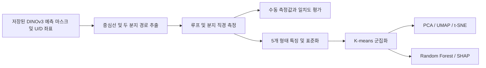

# Capillary Limb

### 손톱주름 모세혈관 직경 자동 정량화 및 형태학적 군집 분석

DINOv3 기반 U-Net 다중 과제 학습(MTL) 모델의 **분할 마스크와 U/D 좌표 예측 결과**를 이용하여 모세혈관의 부위별 직경을 측정하는 연구 프로젝트입니다. 영상의 기하학적 분석부터 수동 측정값과의 일치도 평가, 형태 특징 기반 군집화, SHAP을 이용한 군집 특성 해석까지 연결합니다.

이 저장소는 **예측 결과의 후처리와 분석 코드**를 담고 있습니다. 모델 학습 및 신경망 추론은 상위 모델 프로젝트에서 수행하며, 여기서는 저장된 예측 마스크와 좌표를 입력으로 사용합니다.

## 핵심 구현

- **기하학적 직경 측정**: 중심선에서 두 분지 경로를 추출하고, 국소 접선에 수직인 단면의 폭을 측정합니다. 교차·융합 구간을 구분하고 유효한 측정 구간에서 분지 직경을 선택합니다.
- **측정 품질 추적**: 측정 실패, 유효 후보 부족, 거리 변환 기반 대체 측정 등의 상태와 원인을 결과에 기록하고, 측정 위치를 이미지로 확인합니다.
- **수동 측정과의 비교**: 수동 주석 도구와 자동 측정값을 연결하여 Pearson 상관계수, ICC, 오차 및 Bland–Altman 일치도 분석을 수행합니다.
- **형태 패턴 탐색**: 직경 특징을 표준화한 뒤 K-means 군집화, PCA·UMAP·t-SNE 시각화, Random Forest 대리모델과 SHAP 분석을 수행합니다.
- **입력·결과 추적**: 영상과 fold의 대응, outer-test 예측 여부, 마스크 해시, 알고리즘 해시 및 실행 정보를 검증·기록합니다.

## 분석 흐름



### 측정 특징

| 특징 | 산출 방식 |
| --- | --- |
| Loop diameter | 예측 U/D 두 점 사이의 유클리드 거리 |
| Arterial diameter | 두 분지에서 측정된 직경 중 작은 값 |
| Venous diameter | 두 분지에서 측정된 직경 중 큰 값 |
| Mean diameter | 루프·두 분지 직경의 산술평균 |
| Venous / arterial diameter ratio | 큰 분지 직경 / 작은 분지 직경 |

Arterial/Venous는 본 연구에서 분지 굵기 순서에 따라 부여한 명칭이며, 내부 코드에서는 `thin_branch`/`wide_branch`로 관리합니다. 이 구분만으로 분지의 해부학적 정체성을 독립적으로 판정하지는 않습니다. 직경은 촬영 보정값으로 µm로 변환하며, 직경비에는 단위가 없습니다.

## 코드 구조

```text
Capillary_limb/
├── limb/                         # 기하학적 측정, 시각화, 수동값과 비교
│   ├── analyzer.py               # 단일 마스크의 직경 측정 파이프라인
│   ├── core_algorithm.py         # 중심선·분지 경로 및 단면 처리
│   ├── dinov3_inputs.py           # DINOv3 입력 및 평가 명단 검증
│   ├── main.py                   # 대화형 측정 위치 뷰어
│   ├── export_csv.py             # 직경·측정 좌표 및 QC 이미지 저장
│   ├── compare_measurements.py    # GT 마스크 기반 측정과 수동값 비교
│   ├── compare_predicted_masks.py # 예측 마스크 기반 측정과 수동값 비교
│   └── compare_raters.py          # 측정자 간 비교
├── cluster/                      # 전체 데이터의 형태 특징 분석
│   ├── dinov3_full_clustering.py  # 군집 분석 실행 진입점
│   ├── dinov3_cluster_projection.py
│   ├── dinov3_cluster_interpretation.py
│   ├── dinov3_cluster_plot_style.py
│   └── requirements_dinov3_clustering.txt
├── check/                        # OOF 결과 추출, 입력 대응 및 회귀 검증
└── label/                        # 수동 측정·검토 GUI
```

알고리즘을 살펴보려면 `limb/analyzer.py` → `limb/core_algorithm.py`, 전체 분석 흐름을 살펴보려면 `cluster/dinov3_full_clustering.py` 순서로 읽을 수 있습니다. `limb/predict.py`는 저장된 예측 결과에서 직경을 추출하는 실행 파일입니다.

`K-means.py`, `Hierarchical.py`, `predict2.py`, `total_csv.py` 등은 이전 실험 코드입니다. 현재 DINOv3 분석은 위 표의 진입점을 기준으로 합니다. 일부 기존 문서·파일명에 남은 `144`, `150`은 과거 평가 구성을 가리킵니다.

## 기술 구성

| 영역 | 사용 기술 |
| --- | --- |
| 영상·기하 처리 | OpenCV, scikit-image, NumPy, SciPy |
| 데이터 처리 | pandas |
| 군집화·대리모델 | scikit-learn |
| 비선형 시각화·설명 | umap-learn, SHAP |
| 그래프·수동 주석 | Matplotlib, Pillow, Tkinter |

## 실행 환경

연구에 사용한 군집 분석 환경은 **Windows / Python 3.10.21**이며, 분석 패키지 버전은 [`cluster/requirements_dinov3_clustering.txt`](cluster/requirements_dinov3_clustering.txt)에 기록되어 있습니다. 다음 명령은 저장소 루트에서 실행하는 PowerShell 예시입니다.

```powershell
py -3.10 -m venv .venv
.\.venv\Scripts\python.exe -m pip install -r .\cluster\requirements_dinov3_clustering.txt
.\.venv\Scripts\python.exe -m pip install opencv-python scikit-image Pillow tqdm
$py = ".\.venv\Scripts\python.exe"
```

수동 측정 GUI에는 Tkinter가 필요합니다. 일부 비교 스크립트는 연구 환경의 `Desktop/Capillary_limb`를 기본 import 경로로 사용하므로, 다른 위치에서 실행할 때에는 현재 저장소의 모듈 경로를 함께 지정합니다.

```powershell
$env:PYTHONPATH = "$PWD\check;$PWD\limb;$env:PYTHONPATH"
$env:MPLCONFIGDIR = "$PWD\.cache\matplotlib"
```

동일 PC에 `Desktop/Capillary_limb`의 다른 사본이 있으면 일부 스크립트가 그 사본의 모듈을 먼저 불러올 수 있습니다. 여러 체크아웃을 사용할 때는 각 스크립트의 기본 import 경로도 함께 확인해야 합니다.

## 입력 데이터와 실행 예시

연구 영상, 환자별 명단, 수동 주석, 모델 가중치 및 생성 결과는 공개 코드와 분리하여 관리합니다. 아래 `data/`는 사용자가 입력을 배치하는 예시 경로이며, 저장소에 데이터가 포함되어 있다는 의미는 아닙니다.

### 1. 직경 측정 및 위치 확인

현재 DINOv3 뷰어·측정 실행 경로는 **U / Tortuous / Crossing 각 47장, 총 141장** 평가 명단을 검증합니다. 선택 CSV에는 `Filename`, `Category`가 필요하며, 내부 Category 값은 `U`, `tortuous`, `twist`를 사용합니다. `twist`는 화면의 Crossing에 해당합니다.

모델 결과 폴더에는 다음 자료가 필요합니다.

- `experiment_manifest.json`, `master_predicted_coordinates.csv`
- `fold_1`~`fold_5`의 `patient_split.csv`, `predicted_coordinates.csv`, `predicted_masks/`
- 별도 마스크 루트의 `U/`, `tortuous/`, `crossing/` PNG: 원본 outer-test 마스크와 해시가 일치해야 합니다.

먼저 입력 대응을 확인합니다.

```powershell
& $py .\limb\main.py --run-dir ".\data\model_run" --selection-csv ".\data\selection_141.csv" --mask-dir ".\data\predicted_masks" --check
```

직경·측정 좌표·QC 이미지를 저장합니다. 출력 폴더는 새 이름을 사용합니다.

```powershell
& $py .\limb\export_csv.py --run-dir ".\data\model_run" --selection-csv ".\data\selection_141.csv" --mask-dir ".\data\predicted_masks" --output-dir ".\outputs\geometry_141"
```

`main.py`에서 `--check`를 제거하면 뷰어가 열립니다. GT 마스크를 사용할 때는 `--mask-source gt --mask-dir ".\data\gt_masks"`를 함께 지정합니다. 이때 GT 마스크 명세 파일 `gt_mask_manifest_141.csv`도 필요합니다.

### 2. 수동 측정값과 비교

수동값은 `label/section4_manual_review.py`로 작성한 측정 CSV를 사용합니다. 비교할 측정자를 명확히 선택하도록 `--manual-csv`를 직접 지정합니다.

비교 실행에는 다음 입력도 필요합니다.

- 각 fold의 `fold_summary.txt`, `evaluated_images.csv`
- `--selection-dir` 아래 `U/`, `tortuous/`, `twist/`에 배치한 원본 PNG. 현재 환자 ID 추출 규칙은 `p<숫자>_`로 시작하는 파일명을 사용합니다.
- 선정 영상의 검토 상태가 모두 `approved`인 수동 CSV. U/D와 두 분지 측정 끝점이 유효하고, 기록된 직경이 끝점 거리와 일치해야 합니다.

```powershell
& $py .\limb\compare_predicted_masks.py --run-dir ".\data\model_run" --selection-dir ".\data\selected_images" --selection-csv ".\data\selection_141.csv" --mask-dir ".\data\predicted_masks" --manual-csv ".\data\manual_measurements.csv" --analyzer-dir ".\limb" --output-dir ".\outputs\agreement_141" --um-per-pixel 0.55 --dry-run
```

입력 확인 후 `--dry-run`을 제거하면 비교 결과를 생성합니다. `0.55 µm/px`는 기존 연구 데이터의 보정값이며, 다른 영상에는 해당 촬영 조건의 값을 지정해야 합니다.

GT 마스크와 비교할 때는 `compare_measurements.py`와 `--gt-dir`을 사용합니다. 두 비교 경로 모두 루프 직경과 분지 탐색의 기준점에는 **동일한 예측 U/D 좌표**를 사용합니다.

### 3. 전체 데이터 군집화

군집 분석 입력은 영상별 측정값과 출처를 담은 **canonical CSV**입니다. 위 `export_csv.py`의 `geometry_measurements_141.csv`와는 입력 규격이 다릅니다.

| 구분 | 필수 CSV 열 |
| --- | --- |
| 영상·실행 정보 | `Filename`, `patient_id`, `fold`, `Run_ID` |
| 품질·출처 | `Status`, `Reason`, `Algorithm_SHA256`, `Predicted_Mask`, `Mask_SHA256` |
| 직경 원자료 | `Loop_Diameter_px`, `Estimated_Arterial_Diameter_px`, `Estimated_Venous_Diameter_px` |

입력 CSV와 같은 폴더에 해당 추출 단계의 `provenance.json`을 둡니다. 분석기는 CSV 해시, 전체 행 수, 실행 ID 및 outer-test 마스크 출처 기록을 대조합니다. 아래 `YOUR_RUN_ID`와 `--expected-count`는 입력 데이터와 일치하도록 지정합니다.

```powershell
& $py .\cluster\dinov3_full_clustering.py --input ".\data\full_cohort\canonical_measurements.csv" --output-dir ".\outputs\clustering_k3" --expected-run-id "YOUR_RUN_ID" --expected-count 1397 --feature-set legacy5 --qc-policy measured --k 3 --max-k 6 --um-per-pixel 0.55
```

- 기본 입력은 루프·두 분지·평균 직경·직경비의 **5개 특징**이며, 군집화 전에 z-score 표준화를 적용합니다.
- K-means++ 초기화, `n_init=20`, 난수 시드 42를 사용합니다. K=2~6의 silhouette와 SSE를 계산하고, 최종 K는 `--k`로 지정합니다.
- Ward 계층적 군집화도 보조 비교로 계산합니다. 현재 silhouette·elbow 그림에는 K-means만 표시합니다.
- PCA·UMAP·t-SNE는 기존 군집 라벨의 분포를 시각화합니다. 축소된 좌표로 K-means를 다시 학습하지 않습니다.
- `measured` 정책은 유한한 양의 측정값을 갖는 `Success`와 `Uncertain`을 포함합니다. 제외된 행도 전체 할당표에 사유와 함께 남깁니다.
- Random Forest 대리모델과 SHAP은 K-means 군집 할당에 관련된 특징을 설명합니다.

기존 전체 데이터 실행에서는 **1,397장 중 1,380장**에 군집을 할당하고, 두 분지 직경을 산출하지 못한 **17장**을 제외했습니다. 이는 해당 연구 데이터의 처리 내역이며, 다른 데이터의 처리율을 보장하는 수치는 아닙니다.

## 주요 결과 파일

| 분석 | 출력 |
| --- | --- |
| 직경 측정 | `geometry_measurements_141.csv`, 측정 위치 QC 이미지, `provenance.json` |
| 수동값과 비교 | `comparison_by_image.csv`, `agreement_table_12.csv`, 산점도·Bland–Altman 그림 |
| 군집 수·할당 | `cluster_k_scores.csv`, `cluster_assignments_all.csv`, `clustered_valid_images.csv` |
| 군집 분포 | PCA·UMAP·t-SNE 그림, 투영 좌표 및 설명 분산 |
| 군집 해석 | `interpretation/`의 특징 요약, Kruskal–Wallis·효과크기, RF 및 SHAP 결과 |
| 재현 정보 | 실행 설정, 코드·입력 해시, 패키지 버전 및 품질 상태 |

군집 그래프는 공통 스타일로 PNG·PDF·TIFF를 저장합니다. 데이터 경로와 출력 폴더는 명령행 인자를 우선하며, 인자를 생략하면 일부 스크립트가 기존 연구 PC의 기본 경로를 사용합니다.

## 검증 코드와 해석 범위

`check/test_section4_*.py`, `label/test_section4_manual_review.py`에는 입력 대응, 분지 기하, 평가 통계 및 수동 측정 처리에 대한 검증 코드가 있습니다. 실제 연구 자료가 필요한 검사와 합성 입력으로 수행하는 검사가 함께 포함되어 있습니다.

- 군집화는 정량적 형태 패턴을 탐색하기 위한 분석입니다. 군집을 임상적 진단 범주로 해석하려면 별도의 근거가 필요합니다.
- 군집화에 사용한 특징의 Kruskal–Wallis 검정은 도출된 군집의 차이를 기술합니다. 독립적인 군집 타당성 검증을 의미하지 않습니다.
- 대리모델의 동일 학습 데이터 재현율은 K-means 할당에 대한 적합도를 나타냅니다. 새로운 데이터의 예측 성능과 구분하여 해석합니다.

## 저장소 관리

`.gitignore`는 연구 입력·주석·생성 결과, 모델 파일, Python 캐시와 로컬 환경 설정을 제외하도록 구성했습니다. 공개용 도식이나 집계 그림은 `docs/assets/`에, 직접 작성한 합성 예제는 `examples/synthetic/`에 둘 수 있습니다. 이 예외 폴더에는 공개 가능한 자료만 추가합니다.

일부 스크립트는 연구 당시의 경로와 평가 규모를 기본값으로 사용합니다. 현재 README는 주요 실행 경로를 안내하며, 개별 스크립트의 추가 옵션은 `--help`로 확인할 수 있습니다.
